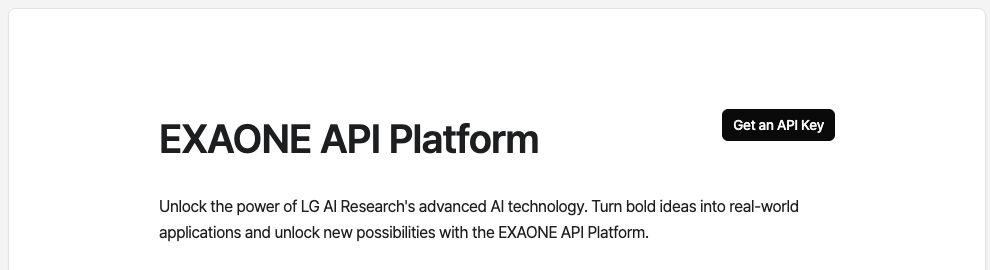
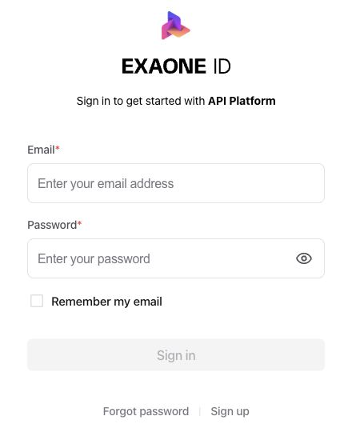

# Get started with EXAONE

Get an EXAONE API key and make your first request with Strands or LangChain. Each user needs their own EXAONE-issued key; the integration packages do not include API access.

## Get an EXAONE API key

1. Open the [EXAONE API Platform](https://docs.exaone.ai/en/docs/overview) and select **Get an API Key**. In the Korean interface, the button is labeled **API Key 발급하기**.

   

2. Sign in with your EXAONE ID, or select **Sign up** below the form to create an account. Follow the platform's instructions to issue a key, then keep it for the next step.

   

Interface labels and account requirements can change, so follow the platform's current instructions. EXAONE's [authentication guide](https://docs.exaone.ai/en/docs/authentication) covers credential handling, and its [rate limits](https://docs.exaone.ai/en/docs/rate-limits) describe the current usage policy.

## Increase your daily limit

To increase your daily API limit, open **My Profile → Consent & Notification Settings** and review the optional consent for usage-data analysis for AI model training and service improvement. Opting in increases the limit. The [official EXAONE FAQ](https://docs.exaone.ai/en/terms/faq) ([한국어](https://docs.exaone.ai/ko/terms/faq)) explains the process.

You can use the API without giving this consent. Check EXAONE's [rate limits](https://docs.exaone.ai/en/docs/rate-limits) for the current policy, including separate per-second, per-minute, and daily request limits. Manage quota and consent in your EXAONE account; the provider does not control them.

## Set your API key

Set the key in the terminal where you will run your program. Replace `your-api-key` with your issued key.

macOS, Linux, or WSL:

```bash
export EXAONE_API_KEY='your-api-key'
```

Windows PowerShell:

```powershell
$env:EXAONE_API_KEY = 'your-api-key'
```

Use the raw key value; the provider adds the `Authorization: Bearer ...` header. These commands apply to the current terminal session. The packages read the process environment and do not load `.env` files automatically. If your application uses a `.env` loader, run it before constructing the model.

Keep the key out of source control and browser code. For deployed applications, supply it through your backend's environment or secret manager.

## Choose a package and run it

Choose the example for your framework and language. You do not need a repository checkout. The providers default to model `k-exaone_v2.5` at `https://api.exaone.ai/v1`, so normal use requires no endpoint configuration.

Use Python 3.10 or newer for Python examples. For TypeScript, use Node.js 22 or newer and run the example through `tsx` as shown. Each invocation sends a request to EXAONE and uses your account's quota; the generated answer can vary.

For Python, create and activate a virtual environment once if you do not already have one:

macOS, Linux, or WSL:

```bash
python3 -m venv .venv
source .venv/bin/activate
```

Windows PowerShell:

```powershell
py -m venv .venv
.\.venv\Scripts\Activate.ps1
```

### Strands: Python

Install the package in the active environment:

```bash
python -m pip install strands-exaone
```

Save this as `agent.py`:

```python
from strands import Agent
from strands_exaone import ExaoneModel, ExaoneRetryStrategy

agent = Agent(
    model=ExaoneModel(),
    retry_strategy=ExaoneRetryStrategy(),
    callback_handler=None,
)
response = agent("Explain what an AI agent is in one sentence.")
for block in response.message["content"]:
    if "text" in block:
        print(block["text"])
```

Run it in the terminal where you set the key:

```bash
python agent.py
```

See the [package reference](../packages/strands-exaone-py/README.md) and [SDK examples](../packages/strands-exaone-py/examples/sdk/) for tools, streaming, and structured output.

### Strands: TypeScript

In a new project directory, initialize the project and install the package and TypeScript runner:

```bash
npm init -y
npm pkg set type=module
npm install strands-exaone
npm install --save-dev tsx
```

Save this as `agent.ts`:

```typescript
import { Agent } from '@strands-agents/sdk'
import { ExaoneModel, ExaoneRetryStrategy } from 'strands-exaone'

const agent = new Agent({
  model: new ExaoneModel(),
  retryStrategy: new ExaoneRetryStrategy(),
  printer: false,
})

try {
  const response = await agent.invoke('Explain what an AI agent is in one sentence.')
  for (const block of response.lastMessage.content) {
    if (block.type === 'textBlock') console.log(block.text)
  }
} finally {
  await agent.shutdown()
}
```

Run it in the terminal where you set the key:

```bash
npx tsx agent.ts
```

Both Strands examples use `ExaoneRetryStrategy` for Agent-level retries. The provider's own HTTP retries are disabled by default. The examples print the answer text and keep complete assistant messages, including supported reasoning, in agent history.

See the [package reference](../packages/strands-exaone-ts/README.md) and [SDK examples](../packages/strands-exaone-ts/examples/sdk/) for tools, streaming, and structured output.

### LangChain: Python

In your Python virtual environment, install the package:

```bash
python -m pip install langchain-exaone
```

Save this as `chat.py`:

```python
from langchain_exaone import ChatEXAONE

model = ChatEXAONE()
response = model.invoke("Explain what an AI agent is in one sentence.")
print(response.text)
```

Run it in the terminal where you set the key:

```bash
python chat.py
```

See the [package reference](../packages/langchain-exaone-py/README.md) and [LangChain examples](../packages/langchain-exaone-py/examples/langchain/) for agents, streaming, and structured output.

### LangChain: TypeScript

In a new project directory, initialize the project and install the package and TypeScript runner:

```bash
npm init -y
npm pkg set type=module
npm install langchain-exaone @langchain/core
npm install --save-dev tsx
```

Save this as `chat.ts`:

```typescript
import { ChatExaone } from 'langchain-exaone'

const model = new ChatExaone()
const response = await model.invoke('Explain what an AI agent is in one sentence.')
console.log(response.content)
```

Run it in the terminal where you set the key:

```bash
npx tsx chat.ts
```

See the [package reference](../packages/langchain-exaone-ts/README.md) and [LangChain examples](../packages/langchain-exaone-ts/examples/langchain/) for agents, streaming, and structured output.

## Troubleshooting

| Symptom | What to check |
| --- | --- |
| The provider cannot find an API key | Set `EXAONE_API_KEY` in the same terminal as your program. A `.env` file alone is not loaded by the provider. |
| HTTP 401 | Check that you are using your issued EXAONE key and that the environment value contains only the key, without a `Bearer ` prefix. |
| HTTP 400 | Check the model ID, request options, and combined input/output token budget against the [model specification](https://docs.exaone.ai/en/docs/k-exaone-2.5). |
| HTTP 429 | Check the account's current [rate limits](https://docs.exaone.ai/en/docs/rate-limits). For a higher daily quota, see [Increase your daily limit](#increase-your-daily-limit). Configured retries honor valid server delay hints; they do not remove service limits. |
| Python cannot import the package | Install with `python -m pip` using the same interpreter that runs your script. |

For other API failures, see EXAONE's [error reference](https://docs.exaone.ai/en/docs/error-codes). For Harness, Strands CLI, LangGraph, and Deep Agents, see the [framework examples](../README.md#examples). To develop these integrations from a checkout, see [CONTRIBUTING.md](../CONTRIBUTING.md).
