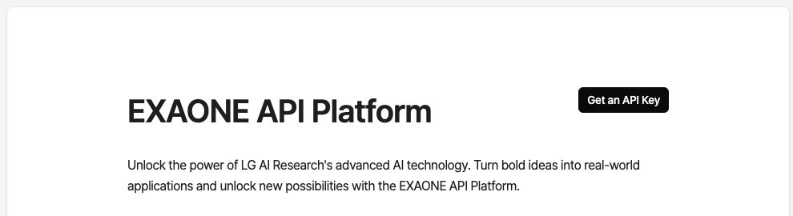
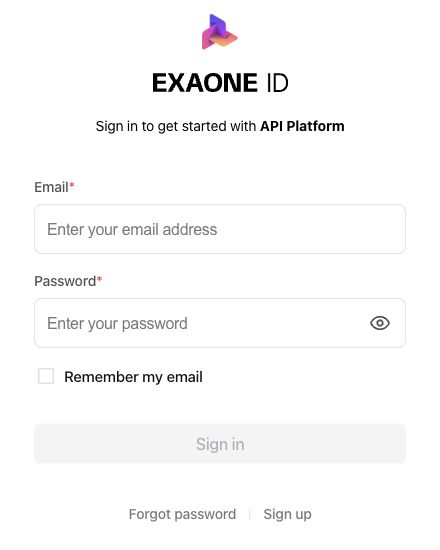

# Get started with EXAONE

Get an EXAONE API key and make your first request with Strands or LangChain. Each user needs their own EXAONE-issued key; the integration packages do not include API access.

## Get an EXAONE API key

1. Open the [EXAONE API Platform](https://docs.exaone.ai/en/docs/overview) and select **Get an API Key**. In the Korean interface, the button is labeled **API Key 발급하기**.

   

2. Sign in with your EXAONE ID, or select **Sign up** below the form to create an account. Follow the platform's instructions to issue a key, then keep it for the next step.

   

Interface labels and account requirements can change, so follow the platform's current instructions. EXAONE's [authentication guide](https://docs.exaone.ai/en/docs/authentication) covers credential handling, and its [rate limits](https://docs.exaone.ai/en/docs/rate-limits) describe the current usage policy.

## Increase your daily limit

To increase your daily API limit, open **My Profile → Consent & Notification Settings** and review the optional consent for usage-data analysis for AI model training and service improvement. Opting in increases the limit. The [official EXAONE FAQ](https://docs.exaone.ai/en/terms/faq) ([한국어](https://docs.exaone.ai/ko/terms/faq)) explains the process.

You can use the API without giving this consent. Check EXAONE's [rate limits](https://docs.exaone.ai/en/docs/rate-limits) for the current policy, including separate per-second, per-minute, and daily request limits. Manage quota and consent in your EXAONE account; the provider does not control them.

## Set your API key

Set the key in the terminal where you will run your program. Replace `your-api-key` with your issued key.

macOS, Linux, or WSL:

```bash
export EXAONE_API_KEY='your-api-key'
```

Windows PowerShell:

```powershell
$env:EXAONE_API_KEY = 'your-api-key'
```

Use the raw key value; the provider adds the `Authorization: Bearer ...` header. These commands apply to the current terminal session. The packages read the process environment and do not load `.env` files automatically. If your application uses a `.env` loader, run it before constructing the model.

Keep the key out of source control and browser code. For deployed applications, supply it through your backend's environment or secret manager.

## Run your first agent

The examples below use the hosted K-EXAONE 2.5 endpoint through `EXAONE_API_KEY`.

| Framework | Python | TypeScript |
| --- | --- | --- |
| Strands Harness | [Quick start](../packages/strands-exaone-py/README.md#quick-start) | [Quick start](../packages/strands-exaone-ts/README.md#quick-start) |
| LangChain Deep Agents | [Quick start](../packages/langchain-exaone-py/README.md#quick-start) | [Quick start](../packages/langchain-exaone-ts/README.md#quick-start) |

For Python, run the quick-start snippet in a virtual environment. For TypeScript, use Node.js 22 or newer, save the snippet as `agent.mts`, and run `npx tsx agent.mts` from the directory where you installed the dependencies.

## Troubleshooting

| Symptom | What to check |
| --- | --- |
| The provider cannot find an API key | Set `EXAONE_API_KEY` in the same terminal as your program. A `.env` file alone is not loaded by the provider. |
| HTTP 401 | Check that you are using your issued EXAONE key and that the environment value contains only the key, without a `Bearer ` prefix. |
| HTTP 400 | Check the model ID, request options, and combined input/output token budget against the [model specification](https://docs.exaone.ai/en/docs/k-exaone-2.5). |
| HTTP 429 | Check the account's current [rate limits](https://docs.exaone.ai/en/docs/rate-limits). For a higher daily quota, see [Increase your daily limit](#increase-your-daily-limit). Configured retries honor valid server delay hints; they do not remove service limits. |
| Python cannot import the package | Install with `python -m pip` using the same interpreter that runs your script. |

For other API failures, see EXAONE's [error reference](https://docs.exaone.ai/en/docs/error-codes). For Harness, Strands CLI, LangGraph, and Deep Agents, see the [framework examples](../README.md#examples). To develop these integrations from a checkout, see [CONTRIBUTING.md](../CONTRIBUTING.md).
